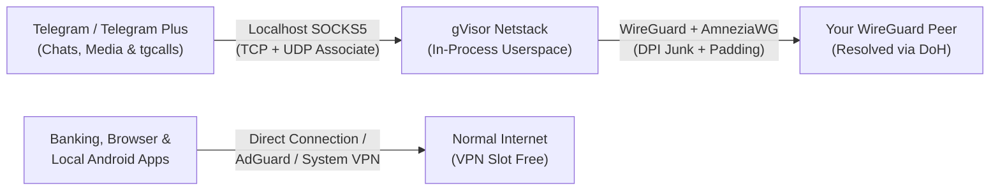

<div align="center">


<br />

[](https://github.com/AliHaider704/wgplus/releases/latest)
[](https://github.com/AliHaider704/wgplus/releases)
[](https://github.com/AliHaider704/wgplus/actions)
[](LICENSE)
[](https://github.com/AliHaider704/wgplus/releases)

**نفق WireGuard و AmneziaWG داخل تليجرام فقط — مصمم لتجاوز حجب تليجرام وفحص الحزم (DPI) بدون روت، وبدون استهلاك خانة الـ VPN، ومع تمرير كامل للمكالمات الصوتية والمرئية.**

[English](README.md) · [تحميل APK](https://github.com/AliHaider704/wgplus/releases/latest) · [مقارنة مع البروكسيات والـ VPN](docs/COMPARISON.md) · [دليل المستخدم](docs/USER_GUIDE.md)

</div>

---

<div dir="rtl">

## لماذا نفق وايرجارد بلس؟

في الدول التي يُحجب فيها تليجرام أو يخضع لفحص الحزم العميق مثل **العراق وإيران والأردن** والشبكات المقيدة المشابهة، يضطر المستخدم عادةً للاختيار بين حلّين ناقصين:

- **بروكسيات تليجرام المجانية (MTProto / SOCKS5):** تُحجب بسرعة، تفرض قنوات إعلانية، لا تصمد أمام الـ DPI، وغالبًا ما تفشل في المكالمات الصوتية والمرئية أو تكشف عنوانك الحقيقي.
- **تطبيقات VPN للنظام كله:** تشغل خانة الـ VPN الوحيدة في أندرويد (فتفصل تطبيقات مثل AdGuard أو VPN العمل)، وتبطئ التطبيقات المحلية والبنكية، وتستنزف البطارية بتمرير كل تطبيقات الهاتف.

**نفق وايرجارد بلس** يحل المشكلتين بتشغيل محرك **WireGuard + AmneziaWG** (`wireguard-go` + `gVisor`) داخل عملية تليجرام نفسها:

| الميزة | وايرجارد بلس | تطبيق VPN للنظام | بروكسي MTProto / SOCKS5 |
|--------|:------------:|:----------------:|:-----------------------:|
| **يمرر تليجرام فقط (بقية التطبيقات لا تتأثر)** | نعم | بصعوبة حسب الاستثناءات | نعم (المحادثات فقط) |
| **يبقي خانة VPN أندرويد فارغة لـ AdGuard أو VPN آخر** | **نعم** | لا | نعم |
| **يعمل بدون روت (عبر LSPatch)** | **نعم** | نعم | نعم |
| **مكالمات صوتية ومرئية مشفرة بدون تسريب P2P** | **نعم** | نعم | غير مستقر / ينقطع |
| **تمويه AmneziaWG ضد الـ DPI وتشفير DNS عبر DoH** | **نعم** | نادر | لا |
| **مانع تسريب صارم وتبديل تلقائي عند الانقطاع** | **نعم** | للنظام كله | لا |
| **بدون قنوات إعلانية أو إجبار اشتراك** | **نعم** | نعم | منتشر في البروكسيات |

اقرأ المقارنة التقنية الكاملة في [صفحة المقارنة (بالإنجليزية)](docs/COMPARISON.md).

---

## لقطات الشاشة والعرض التوضيحي

<div align="center">
  
</div>

<details>
<summary><strong>عرض متحرك للواجهة (الوضع الداكن والفاتح، DNS المشفر، وتمويه AmneziaWG)</strong></summary>

<div align="center">
  <br />
  
</div>

</details>

---

## آلية العمل

</div>



<div dir="rtl">

- يعمل مع **تليجرام بلس** (`org.telegram.plus`) و**تليجرام الرسمي** (`org.telegram.messenger`).
- مبني بخطافات آمنة (`XC_MethodHook`) ليتعايش مع الإضافات الأخرى مثل **TeleVip** بدون أي تعارض.

> مشروع مجتمعي غير رسمي، وليس تابعًا لتليجرام أو WireGuard أو Amnezia.

---

## المميزات الأساسية

- **نفق داخل عملية تليجرام فقط (بدون روت):** لا يستهلك خانة VPN النظام ولا يبطئ تطبيقاتك المحلية أو البنكية.
- **حماية المكالمات الصوتية والمرئية:** يمرر إشارات المكالمات ووسائط UDP عبر النفق ويعطّل الاتصال المباشر (P2P) أثناء التفعيل لمنع كشف عنوان IP الحقيقي.
- **تمويه الحزم AmneziaWG:** دعم كامل لقيم `Jc`/`Jmin`/`Jmax` و`S1`–`S4` و`H1`–`H4` مع زر تمويه جاهز بضغطة واحدة يعمل حتى مع خوادم WireGuard العادية.
- **مانع تسريب صارم وتشفير DNS عبر DoH:** يحجب اتصال تليجرام تمامًا إذا سقط النفق، ويفك اسم نطاق الخادم عبر DNS-over-HTTPS لتجاوز حجب مزود الإنترنت.
- **إدارة عدة خوادم والتبديل التلقائي:** استيراد ملفات `.conf`، اللصق من الحافظة، قراءة رمز QR من لقطة شاشة (بدون صلاحية الكاميرا)، قياس سرعة كل الخوادم والانتقال للأسرع، التحويل التلقائي لخادم بديل، واكتشاف أنسب MTU للشبكة.
- **حماية استمرارية صامتة ومستقلة (`v1.5.0`) بدون تطبيقات مساعدة:** تفعيل مدمج لمرة واحدة فقط برمز من ٦ أرقام عبر التصحيح اللاسلكي على أندرويد 11+ (أو تفعيل تلقائي بالروت)، مع استثناءات الطاقة والبيانات وإعادة التشغيل بدون إشعارات دائمة.
- **خصوصية وواجهة ثنائية اللغة:** تشفير المفاتيح الخاصة بمخزن مفاتيح أندرويد (`AES-256-GCM`)، وواجهة عربية (RTL) وإنجليزية (LTR) بالوضعين الداكن والفاتح.

---

## التثبيت خلال ٣ دقائق

تحتاج هاتف أندرويد **5.0 أو أحدث** (وللتفعيل الصامت لمرة واحدة برمز من ٦ أرقام تحتاج أندرويد **11 أو أحدث**) وملف إعداد WireGuard أو AmneziaWG بصيغة `.conf`.

### أ. التثبيت بدون روت عبر LSPatch (الموصى به)

لا تحتاج أي تطبيق مساعد خارجي. اختر وضع **Portable** (الأبسط) أو وضع **Local** (لتحديث WireGuard Plus مستقبلًا بدون إعادة دمج تليجرام):

1. حمّل وثبّت آخر نسخة `WireGuardPlus-<version>.apk` من [صفحة الإصدارات (Releases)](https://github.com/AliHaider704/wgplus/releases).
2. ثبّت [JingMatrix LSPatch](https://github.com/JingMatrix/LSPatch)، وادخل إلى **Manage -> +** ثم اختر ملف APK الخاص بـ **تليجرام بلس** أو **تليجرام الرسمي** (انسخ المحادثات السرية احتياطيًا قبل استبدال النسخة الأصلية إذا اختلف التوقيع).
3. اختر **Portable** (وحدّد **Embed modules -> WireGuard Plus** مع أي إضافة أخرى مثل **TeleVip**) **أو Local** (فعّل **WireGuard Plus** من **LSPatch -> Modules** واختر تليجرام ضمن نطاقها).
4. اضغط **Start Patch** وثبّت تليجرام المدمج ثم سجّل الدخول.
5. افتح تطبيق **نفق وايرجارد بلس**، واضغط **تنشيط الحماية واستثناءات البطارية الآن**، واسمح بالإشعارات، ثم أدخل رمز التصحيح اللاسلكي ذي الـ ٦ أرقام لمرة واحدة فقط.

### ب. هاتف يحتوي على روت عبر LSPosed

1. ثبّت `WireGuardPlus-<version>.apk` من [Releases](https://github.com/AliHaider704/wgplus/releases).
2. افتح **LSPosed -> Modules -> WireGuard Plus**، وفعّل الإضافة وحدد **تليجرام بلس** و/أو **تليجرام الرسمي**.
3. أوقف تليجرام إجباريًا ثم افتحه من جديد.
4. افتح **نفق وايرجارد بلس** وامنح صلاحية الروت لتفعيل أقصى حماية بالخلفية بصمت بدون إشعارات.

---

## أول اتصال

1. داخل تليجرام، افتح **الإعدادات -> البيانات والتخزين -> إعدادات البروكسي**.
2. اضغط زر **نفق وايرجارد** أسفل الشاشة (أو اضغط مطولًا على شريط العنوان).
3. أضف الخادم عبر **استيراد ملف** (`.conf`) أو **صورة رمز** (QR) أو **لصق** من الحافظة.
4. أبقِ خيار **تمرير المكالمات الصوتية والمرئية عبر النفق** مفعّلًا.
5. اضغط **اتصال**، ثم اضغط **فحص المسار والمكالمات** للتأكد من تغيّر الـ IP الخارجي وجاهزية المكالمات.

راجع [دليل المستخدم](docs/USER_GUIDE.md) لحلول المشاكل الشائعة.

---

## البناء من المصدر

على ويندوز (يتطلب Go وAndroid NDK و`gomobile` وJDK 21 وAndroid SDK):

```powershell
# 1. بناء محرك Go وتشغيل اختباراته
powershell -ExecutionPolicy Bypass -File .\scripts\build-wgbridge.ps1

# 2. تشغيل اختبارات أندرويد وبناء APK (ينتج في dist/)
.\gradlew.bat testReleaseUnitTest assembleRelease
```

التفاصيل الكاملة في [دليل البناء](docs/BUILD_GUIDE.md).

---

## التوثيق والملفات

- [المقارنة مع البروكسيات والـ VPN](docs/COMPARISON.md)
- [دليل المستخدم وحل المشاكل](docs/USER_GUIDE.md)
- [دليل البناء](docs/BUILD_GUIDE.md)
- [المعمارية التقنية](docs/ARCHITECTURE.md)
- [نموذج الأمان والخصوصية](docs/SECURITY.md)
- [سجل التغييرات](CHANGELOG.md)
- [المساهمة في المشروع](CONTRIBUTING.md)
- [الإبلاغ عن الثغرات](SECURITY.md)

---

## الشكر والترخيص

مبني على [wireguard-go](https://git.zx2c4.com/wireguard-go) و[gVisor](https://gvisor.dev) و[gomobile](https://pkg.go.dev/golang.org/x/mobile) و[ZXing](https://github.com/zxing/zxing) و[libadb-android](https://github.com/MuntashirAkon/libadb-android) و[Conscrypt](https://conscrypt.org/) وأفكار تمويه الحزم من [AmneziaWG](https://github.com/amnezia-vpn/amneziawg-go).

الترخيص: [MIT](LICENSE)

</div>
