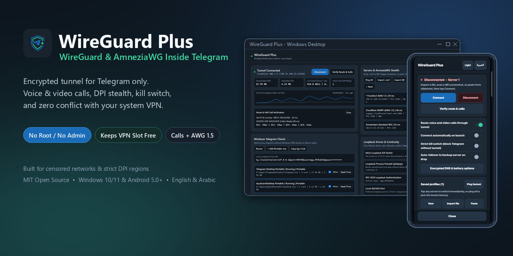
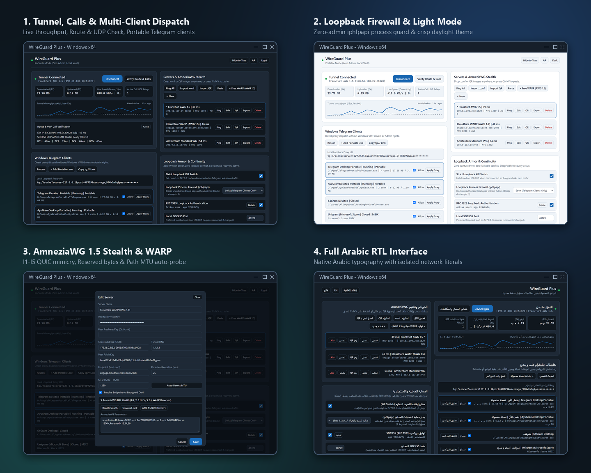
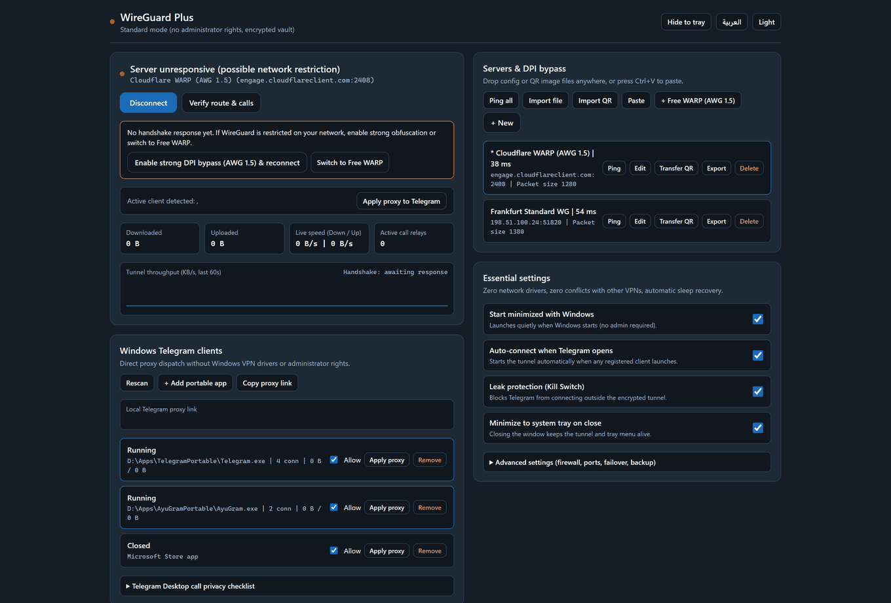
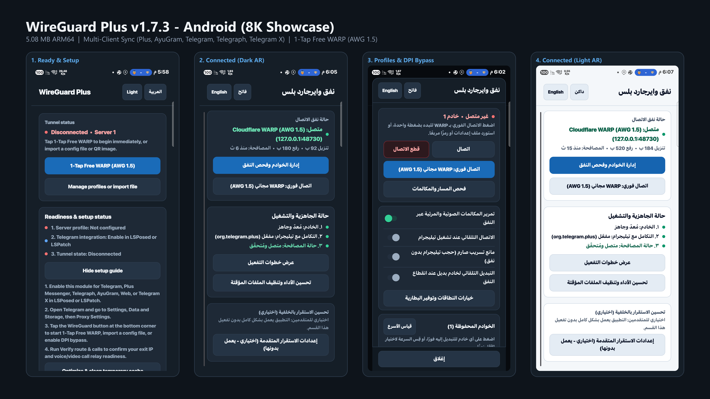
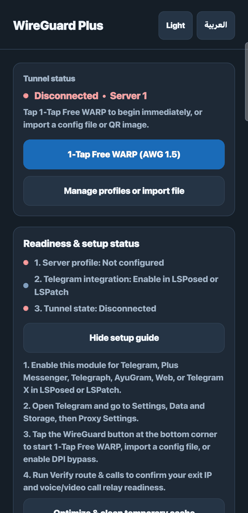
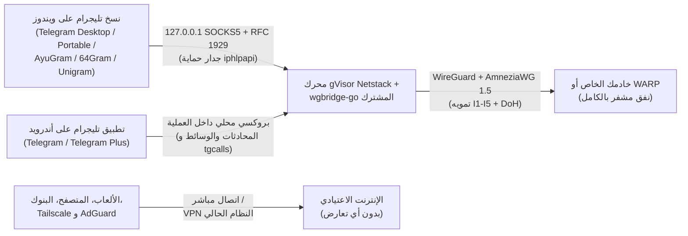

<div align="center">



<h1>WireGuard Plus - نفق وايرجارد وأمنيزيا داخل تليجرام</h1>

[](https://github.com/AliHaider704/wgplus/releases/latest)
[](https://github.com/AliHaider704/wgplus/releases)
[](https://github.com/AliHaider704/wgplus/actions)
[](LICENSE)
[](https://github.com/AliHaider704/wgplus/releases/latest)
[](https://github.com/AliHaider704/wgplus/releases/latest)

**نفق WireGuard و AmneziaWG 1.5 داخل تليجرام فقط - لتجاوز الحجب وفحص الحزم (DPI) على ويندوز (بدون صلاحيات مسؤول، وبدون تعريف Wintun أو تعارض مع Tailscale، وبوضع محمول كامل) وعلى أندرويد (بدون روت وبدون استهلاك خانة الـ VPN) مع تمرير المكالمات الصوتية والمرئية.**

<p dir="ltr">
  <a href="README.md">English</a> ·
  <a href="https://github.com/AliHaider704/wgplus/releases/latest">Download Windows / Android</a> ·
  <a href="docs/COMPARISON.md">Compare vs Proxies &amp; VPNs</a> ·
  <a href="docs/USER_GUIDE.md">User Guide</a>
</p>

</div>

---

<div dir="rtl">

## التحميل (`v1.6.1`)

| المنصة | رابط التحميل | المتطلبات | الملاحظات |
|--------|--------------|-----------|-----------|
| **ويندوز (ملف `.exe` مفرد)** | [`WireGuardPlus-Windows-x64.exe`](https://github.com/AliHaider704/wgplus/releases/latest/download/WireGuardPlus-Windows-x64.exe) | ويندوز 10/11 (x64)، بدون مسؤول | تشغيل مباشر، تشفير DPAPI، أيقونة شريط النظام |
| **ويندوز المحمول (`.zip`)** | [`WireGuardPlus-Windows-x64-Portable.zip`](https://github.com/AliHaider704/wgplus/releases/latest/download/WireGuardPlus-Windows-x64-Portable.zip) | ويندوز 10/11 (x64)، فلاش/مجلد | يحتوي `portable.flag`، حفظ محلي كامل بدون AppData |
| **أندرويد (LSPatch / LSPosed)** | [`WireGuardPlus-1.5.0.apk`](https://github.com/AliHaider704/wgplus/releases/latest/download/WireGuardPlus-1.5.0.apk) | أندرويد 5.0+ (11+ للتفعيل الصامت) | بدون روت عبر LSPatch أو بالروت عبر LSPosed |

تحقق من تطابق الملفات عبر [`SHA256SUMS.txt`](https://github.com/AliHaider704/wgplus/releases/latest/download/SHA256SUMS.txt) أو شاهد [فيديو الشرح العملي لويندوز (`MP4`)](https://github.com/AliHaider704/wgplus/releases/latest/download/WireGuardPlus-Windows-Walkthrough.mp4).

---

## لماذا نفق وايرجارد بلس؟

في الدول التي يُحجب فيها تليجرام أو يخضع لفحص الحزم العميق مثل **العراق وإيران والأردن** والشبكات المقيدة المشابهة، يضطر المستخدم عادةً للاختيار بين حلّين ناقصين:

- **بروكسيات تليجرام المجانية (MTProto / SOCKS5):** تُحجب بسرعة، تفرض قنوات إعلانية، لا تصمد أمام الـ DPI، وغالبًا ما تفشل في المكالمات الصوتية والمرئية أو تكشف عنوانك الحقيقي.
- **تطبيقات VPN للنظام كله:** تنصّب تعريفات Wintun أو تشغل خانة الـ VPN الوحيدة (فتتعارض مع Tailscale أو AdGuard أو VPN العمل)، وتبطئ المتصفح والألعاب والتطبيقات المحلية.

**نفق وايرجارد بلس** يحل المشكلتين بتشغيل محرك **WireGuard + AmneziaWG 1.5** (`wireguard-go` + `gVisor`) في مساحة المستخدم لتليجرام فقط:

| الميزة | وايرجارد بلس (ويندوز + أندرويد) | تطبيق VPN للنظام | بروكسي MTProto / SOCKS5 |
|--------|:--------------------------------:|:----------------:|:-----------------------:|
| **يمرر تليجرام فقط (الألعاب والمتصفح والتطبيقات البنكية لا تتأثر)** | **نعم** | بصعوبة حسب الاستثناءات | نعم (المحادثات فقط) |
| **بدون روت / بدون صلاحيات مسؤول / بدون استهلاك خانة VPN أو تعارض Tailscale** | **نعم** (بدون تعريف Wintun) | لا | نعم |
| **دعم تعدد نسخ ويندوز (تليجرام المحمول، AyuGram، 64Gram، Unigram)** | **نعم** | استثناءات يدوية محدودة | يدوي لكل نسخة |
| **مكالمات صوتية ومرئية مشفرة بدون تسريب P2P** | **نعم** | نعم | غير مستقر / ينقطع |
| **تمويه AmneziaWG 1.5 (`I1`-`I5` QUIC) و WARP و DoH مشفر** | **نعم** | نادر | لا |
| **مانع تسريب صارم + جدار حماية محلي `iphlpapi` (لويندوز)** | **نعم** | للنظام كله | لا |
| **بدون قنوات إعلانية أو إجبار اشتراك** | **نعم** | نعم | منتشر في البروكسيات |

اقرأ المقارنة التقنية الكاملة في [صفحة المقارنة (بالإنجليزية)](docs/COMPARISON.md).

---

## لقطات الشاشة والعرض التوضيحي

### نسخة ويندوز (Windows Desktop)

<div align="center">
  
</div>

<details>
<summary><strong>عرض متحرك لواجهة ويندوز (التشغيل بدون مسؤول، تمويه AWG 1.5، الوضع الفاتح، QR والعربية)</strong></summary>

<div align="center">
  <br />
  
  <br />
  <sub>تفضّل الفيديو عالي الدقة؟ شاهد أو حمّل <a href="https://github.com/AliHaider704/wgplus/releases/latest/download/WireGuardPlus-Windows-Walkthrough.mp4">WireGuardPlus-Windows-Walkthrough.mp4</a>.</sub>
</div>

</details>

### نسخة أندرويد (داخل تليجرام)

<div align="center">
  
</div>

<details>
<summary><strong>عرض متحرك لواجهة أندرويد (الوضع الداكن والفاتح، DNS المشفر، وتمويه AmneziaWG)</strong></summary>

<div align="center">
  <br />
  
</div>

</details>

---

## آلية العمل

</div>



<div dir="rtl">

- **ويندوز:** يكتشف تلقائيًا نسخ **Telegram Desktop** و**النسخ المحمولة Portable** و**AyuGramDesktop** و**64Gram** و**Unigram** و**Forkgram** بدون صلاحيات مسؤول أو تعريفات شبكة، ويحمي منفذ `127.0.0.1` بجدار عمليات عبر `iphlpapi` مع بقاء Tailscale والألعاب دون تأثر.
- **أندرويد:** يندمج مباشرة داخل **تليجرام بلس** (`org.telegram.plus`) و**تليجرام الرسمي** (`org.telegram.messenger`) بخطافات آمنة (`XC_MethodHook`) ليتعايش مع الإضافات الأخرى مثل **TeleVip** بدون تعارض.

> مشروع مجتمعي غير رسمي، وليس تابعًا لتليجرام أو WireGuard أو Cloudflare أو Amnezia.

---

## المميزات الأساسية

- **عزل حقيقي داخل تليجرام (بدون خانة VPN وبدون مسؤول/روت):** يشغّل `wireguard-go` و`gVisor` في مساحة المستخدم (`desktopMode` يرفع طوابير النفق إلى `8192` وتجميع `128` حزمة ونوافذ TCP حتى `16 MB` على الكمبيوتر) بدون المساس بجدول توجيه النظام أو تعريف Wintun.
- **تمويه AmneziaWG 1.0 / 1.5 (`I1`-`I5`) و Cloudflare WARP:** دعم كامل لقيم `Jc`/`Jmin`/`Jmax` و`S1`-`S4` و`H1`-`H4` وحزم التوقيع `I1`-`I5` (محاكاة QUIC) وبصمة `Reserved` لـ WARP مع زر **+ توليد WARP مجاني (AWG 1.5)** بضغطة واحدة على ويندوز.
- **حماية مدرعة لمنفذ ويندوز المحلي (`v1.6.0`):** جدار حماية `iphlpapi` بدون مسؤول (`GetExtendedTcpTable` / `GetExtendedUdpTable` للتحقق من مسار التطبيق ومنع أي برنامج غير مصرح له)، ومصادقة RFC 1929 بكلمة مرور عشوائية تلقائية، ومانع تسريب صارم، وخيار HTTP CONNECT محلي لمن يحتاجه.
- **حماية المكالمات الصوتية والمرئية:** يمرر وسائط UDP عبر SOCKS5 `UDP ASSOCIATE` مع احتياطي TCP. على أندرويد يُعطّل P2P تلقائيًا؛ وعلى ويندوز فعّل خيار **الإعدادات -> الخصوصية والأمان -> المكالمات -> نظير لنظير: لا أحد** مرة واحدة داخل تليجرام لحماية الـ IP الحقيقي.
- **DNS مشفر (DoH) وفحص شامل للنفق:** يدعم `1.1.1.1` و`1.0.0.1` و`8.8.8.8` و`9.9.9.9` أو رابط DoH مخصص مع رفض العناوين المزورة، ويفحص الـ IP الخارجي والدولة وسرعة مراكز بيانات تليجرام `DC1/DC2/DC4/DC5` وجاهزية مكالمات UDP.
- **تشفير DPAPI والوضع المحمول والنسخ الاحتياطي المشفر:** تُشفّر المفاتيح على ويندوز عبر DPAPI (`CryptProtectData`)، ووضع `portable.flag` يحفظ كل البيانات في `./wgplus-data/`، بينما ملفات `.wgplus` (Argon2id + AES-256-GCM) تنقل إعداداتك بأمان بين الأجهزة. على أندرويد تُحفظ المفاتيح في `AndroidKeyStore`.
- **استمرارية موثوقة وواجهة عربية كاملة:** تعافي تلقائي على ويندوز عند السكون/الاستيقاظ (`WM_POWERBROADCAST`) وتغيّر الشبكة (`NotifyIpInterfaceChange`) وأيقونة شريط النظام، وحماية صامتة على أندرويد عبر التصحيح اللاسلكي لمرة واحدة أو الروت. واجهة عربية (RTL) وإنجليزية (LTR) بالوضعين الداكن والفاتح.

---

## التثبيت السريع

### أولًا: ويندوز (خلال دقيقة، بدون صلاحيات مسؤول)

يتطلب **ويندوز 10 أو 11 (x64)**.

1. حمّل [`WireGuardPlus-Windows-x64.exe`](https://github.com/AliHaider704/wgplus/releases/latest/download/WireGuardPlus-Windows-x64.exe) أو فك ضغط [`WireGuardPlus-Windows-x64-Portable.zip`](https://github.com/AliHaider704/wgplus/releases/latest/download/WireGuardPlus-Windows-x64-Portable.zip).
2. شغّل `WireGuardPlus.exe` (لا يطلب مسؤول UAC ولا ينصّب تعريفات).
3. أضف خادمك عبر **استيراد `.conf`** أو **استيراد QR** أو **لصق (Ctrl+V)** أو اضغط **+ توليد WARP مجاني (AWG 1.5)** ثم اضغط **اتصال**.
4. من بطاقة **تطبيقات تليجرام على ويندوز** حدد نسختك (Telegram Desktop أو النسخة المحمولة أو AyuGramDesktop أو 64Gram أو Unigram أو أضف مسارًا يدويًا عبر **+ إضافة نسخة محمولة**) واضغط **تطبيق البروكسي**.
5. لخصوصية المكالمات على الكمبيوتر: اضبط **الإعدادات -> الخصوصية والأمان -> المكالمات -> نظير لنظير: لا أحد** داخل تليجرام مرة واحدة، ثم اضغط **فحص المسار والمكالمات** للتأكد من الجاهزية.

### ثانيًا: أندرويد (خلال ٣ دقائق، بدون روت أو بالروت)

يتطلب **أندرويد 5.0+** (**أندرويد 11+** للتفعيل الصامت عبر التصحيح اللاسلكي).

1. حمّل [`WireGuardPlus-1.5.0.apk`](https://github.com/AliHaider704/wgplus/releases/latest/download/WireGuardPlus-1.5.0.apk).
2. **بدون روت (LSPatch):** ادمج **تليجرام بلس** (`org.telegram.plus`) أو **تليجرام الرسمي** (`org.telegram.messenger`) عبر [JingMatrix LSPatch](https://github.com/JingMatrix/LSPatch) بوضع **Portable** أو **Local**، ثم ثبّت تليجرام وافتح تطبيق **نفق وايرجارد بلس** لإكمال ربط التصحيح اللاسلكي ذي الـ 6 أرقام لمرة واحدة.
   - **مع روت (LSPosed):** فعّل **WireGuard Plus** في **LSPosed -> Modules** وحدد تليجرام ثم امنح الروت داخل التطبيق لحماية صامتة.
3. داخل تليجرام افتح **الإعدادات -> البيانات والتخزين -> إعدادات البروكسي -> نفق وايرجارد** وأضف ملفك واتصل.

التفاصيل الكاملة وحلول المشاكل في [دليل المستخدم](docs/USER_GUIDE.md).

---

## التحقق من الملفات و SmartScreen وشفافية الشبكة (ويندوز)

للتحقق من سلامة ملف ويندوز ومطابقته لملف [`SHA256SUMS.txt`](https://github.com/AliHaider704/wgplus/releases/latest/download/SHA256SUMS.txt) عبر PowerShell:

```powershell
Get-FileHash .\WireGuardPlus-Windows-x64.exe -Algorithm SHA256
```

- **بخصوص تنبيه SmartScreen أو Defender (`!ml`):** لأن المشروع مفتوح المصدر ومجاني بدون شهادة توقيع تجارية مدفوعة، قد يُظهر ويندوز تنبيه SmartScreen عند التشغيل الأول لنسخ Go + Wails الجديدة. الملف **لا يستخدم UPX أو أي أدوات ضغط مشفرة**، ويمكن بناؤه مباشرة من المصدر أو التحقق من سجل البناء الموثّق (SLSA provenance) عبر [`.github/workflows/release-windows.yml`](.github/workflows/release-windows.yml).
- **شفافية الاتصالات الخارجية (صفر تتبع أو تحليلات):** التطبيق لا يتصل بأي خادم تحليلات أو فحص تحديثات في الخلفية؛ جميع اتصالاته الممكنة محصورة بالتالي فقط:

| الغرض | الوجهة | متى يحدث؟ |
|-------|--------|-----------|
| حزم نفق WireGuard / AWG 1.5 المشفرة | عنوان خادم `.conf` الخاص بك (أو WARP) | أثناء الاتصال فقط |
| فك اسم نطاق الخادم عبر DoH المشفر | `1.1.1.1` و `1.0.0.1` و `8.8.8.8` و `9.9.9.9` (أو خادم DoH مخصص) | عند الاتصال بنطاق DNS |
| فحص الـ IP الخارجي ومراكز بيانات تليجرام و UDP | `one.one.one.one/cdn-cgi/trace` و `1.1.1.1:53` ومراكز `DC1/2/4/5` عبر النفق | فقط عند ضغط **فحص المسار والمكالمات** |
| تسجيل جهاز Cloudflare WARP مجاني | `https://api.cloudflareclient.com/v0a2158/reg` | فقط عند ضغط **+ توليد WARP مجاني** |

---

## البناء من المصدر

```powershell
# 1. نسخة ويندوز (يتطلب Go 1.26+ و Wails v2.17.1): يشغّل الاختبارات وينتج dist/*.exe و Portable.zip
powershell -ExecutionPolicy Bypass -File .\scripts\build-windows.ps1

# 2. نسخة أندرويد (يتطلب Go + NDK + gomobile + JDK 21 + Android SDK): ينتج dist/*.apk
powershell -ExecutionPolicy Bypass -File .\scripts\build-wgbridge.ps1
.\gradlew.bat testReleaseUnitTest assembleRelease
```

التفاصيل الكاملة في [دليل البناء](docs/BUILD_GUIDE.md).

---

## التوثيق والملفات

- [المقارنة مع البروكسيات والـ VPN](docs/COMPARISON.md)
- [دليل المستخدم وحل المشاكل](docs/USER_GUIDE.md)
- [دليل البناء](docs/BUILD_GUIDE.md)
- [المعمارية التقنية](docs/ARCHITECTURE.md)
- [نموذج الأمان والخصوصية](docs/SECURITY.md)
- [سجل التغييرات](CHANGELOG.md)
- [المساهمة في المشروع](CONTRIBUTING.md)
- [الإبلاغ عن الثغرات](SECURITY.md)

---

## الشكر والترخيص

مبني على [wireguard-go](https://git.zx2c4.com/wireguard-go) و[gVisor](https://gvisor.dev) و[Wails v2](https://wails.io) و[gomobile](https://pkg.go.dev/golang.org/x/mobile) و[ZXing](https://github.com/zxing/zxing) و[gozxing](https://github.com/makiuchi-d/gozxing) و[libadb-android](https://github.com/MuntashirAkon/libadb-android) و[Conscrypt](https://conscrypt.org/) وبروتوكولات تمويه الحزم من [AmneziaWG](https://github.com/amnezia-vpn/amneziawg-go).

الترخيص: [MIT](LICENSE)

</div>
