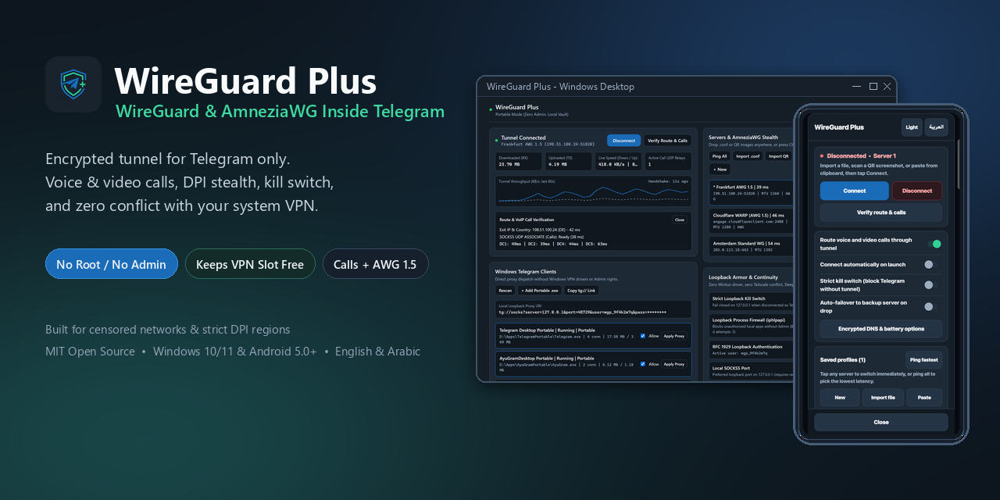
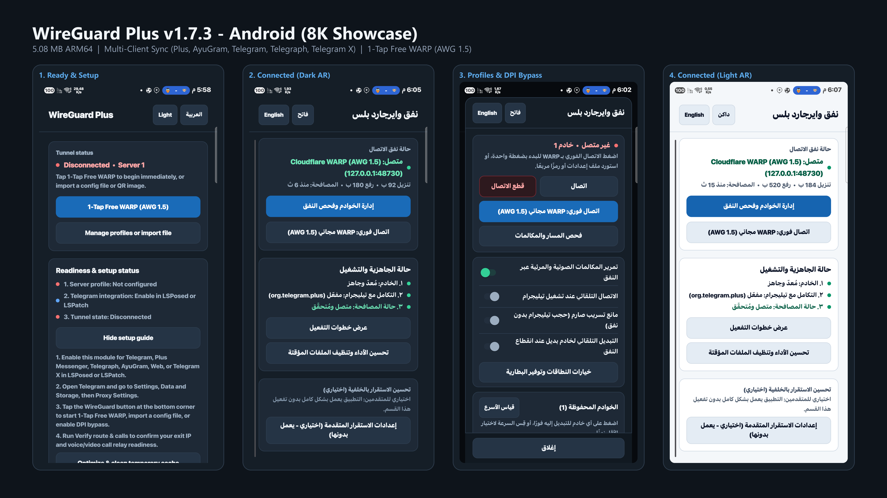
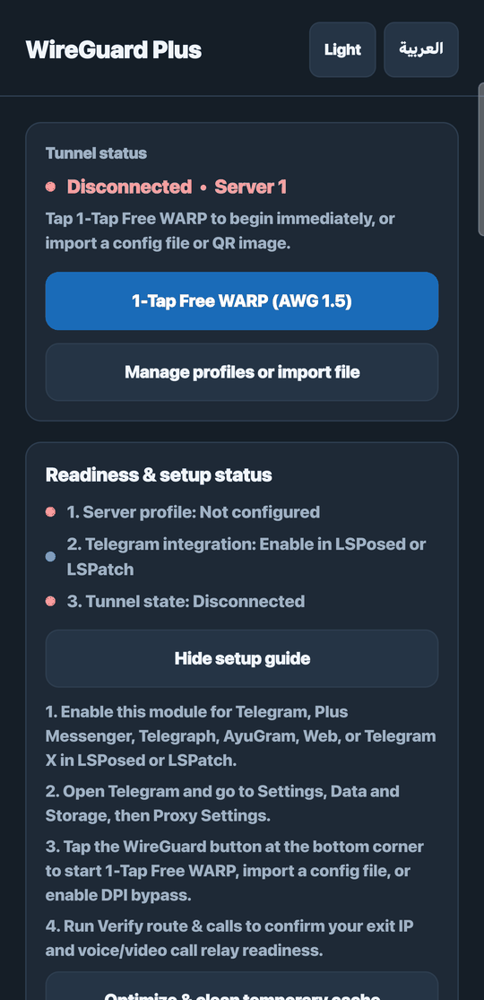
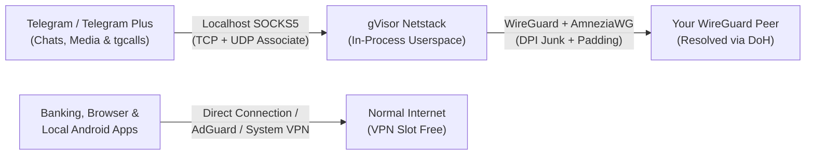

<div align="center">



<h1>WireGuard Plus — WireGuard &amp; AmneziaWG Inside Telegram</h1>

[](https://github.com/AliHaider704/wgplus/releases/latest)
[](https://github.com/AliHaider704/wgplus/releases)
[](https://github.com/AliHaider704/wgplus/actions)
[](LICENSE)
[](https://github.com/AliHaider704/wgplus/releases)

**WireGuard & AmneziaWG inside Telegram only — built to bypass Telegram blocks and DPI throttling without root, without occupying Android's VPN slot, and with encrypted voice & video calls.**

<p dir="ltr">
  <a href="README.ar.md">العربية (Arabic)</a> ·
  <a href="https://github.com/AliHaider704/wgplus/releases/latest">Download APK</a> ·
  <a href="docs/COMPARISON.md">Compare vs Proxies &amp; VPNs</a> ·
  <a href="docs/USER_GUIDE.md">User Guide</a>
</p>

</div>

---

## Why WireGuard Plus?

In countries where Telegram is blocked or subjected to Deep Packet Inspection (such as **Iran, Iraq, Jordan**, and similar restricted networks), users usually settle for two flawed options:

- **Public MTProto / SOCKS5 proxies** get blocked quickly, inject sponsored channels, fail under DPI, and break or leak your real IP on voice/video calls.
- **System-wide VPN apps** hijack Android's only VPN slot (kicking off AdGuard or work VPNs), slow down local banking/domestic apps, and drain battery tunneling your entire phone.

**WireGuard Plus** solves both by embedding a userspace **WireGuard + AmneziaWG** engine (`wireguard-go` + `gVisor` netstack) directly inside the Telegram process:

| Feature | WireGuard Plus | System VPN App | MTProto / SOCKS5 Proxy |
|---------|:--------------:|:--------------:|:----------------------:|
| **Tunnels only Telegram (local apps untouched)** | Yes | Workarounds only | Yes (chats only) |
| **Keeps Android VPN slot free (AdGuard / 2nd VPN)** | **Yes** | No | Yes |
| **Rootless support (LSPatch)** | **Yes** | Yes | Yes |
| **Encrypted voice & video calls (UDP + no P2P IP leak)** | **Yes** | Yes | Unreliable / breaks |
| **AmneziaWG DPI obfuscation & DoH endpoint lookup** | **Yes** | Rare | No |
| **Strict in-process kill switch & multi-server failover** | **Yes** | System-wide | No |
| **Zero channel spam / zero proxy ads** | **Yes** | Yes | Often ad-injected |

See the full technical breakdown in [WireGuard Plus vs Proxies & System VPNs](docs/COMPARISON.md).

---

## Screenshots & Walkthrough

<div align="center">
  
</div>

<details>
<summary><strong>Animated UI walkthrough (Dark & Light themes, Encrypted DNS, AmneziaWG)</strong></summary>

<div align="center">
  <br />
  
</div>

</details>

---

## How It Works



- Works with **Telegram Plus** (`org.telegram.plus`) and official **Telegram** (`org.telegram.messenger`).
- Designed with non-destructive hooks (`XC_MethodHook`) so it coexists cleanly with other modules such as **TeleVip**.

> Unofficial community project; not affiliated with Telegram, WireGuard, or Amnezia.

---

## Core Capabilities

- **In-Process Tunnel (Zero Root Required):** Runs `wireguard-go` and `gVisor` inside Telegram without using Android's `VpnService` slot.
- **Voice & Video Calls Protected:** Hooks Telegram's call engine (`tgcalls`) over SOCKS5 UDP (`UDP ASSOCIATE` + TCP fallback) and disables direct P2P IP exposure while active.
- **AmneziaWG DPI Obfuscation:** Supports full `Jc`/`Jmin`/`Jmax`, `S1`–`S4`, and `H1`–`H4` parameters, plus a one-tap universal junk preset that works even with standard WireGuard servers.
- **Strict Kill Switch & Encrypted DoH:** Drops all Telegram traffic if the tunnel goes down, and resolves server hostnames over DNS-over-HTTPS so ISPs cannot poison or log lookups.
- **Multi-Server Management & Auto-Failover:** Import `.conf` files, paste from clipboard, scan QR screenshots from gallery (no camera permission), ping all servers to jump to the fastest, auto-failover on drops, and auto-detect optimal mobile MTU.
- **24/7 Silent Continuity (`v1.5.0`, Zero Helper Apps):** Built-in Wireless Debugging one-time 6-digit pairing (Android 11+), automatic Doze/Data-Saver/Samsung MARs exemptions, automatic root kernel boost when rooted, and a zero-capture Boot Guard — keeping Telegram connected across Wi-Fi, Mobile Data, and reboots with **zero ongoing notification**.
- **Privacy & Bilingual UI:** Private keys and pairing credentials are encrypted with Android Keystore (`AES-256-GCM`). Full English (LTR) and Arabic (RTL) support in Dark and Light themes.

---

## Install in 3 Minutes

You need Android **5.0+** (Android **11+** for one-time silent Wireless Debugging activation) and a WireGuard/AmneziaWG `.conf` file from your server or VPN provider.

### Option A: Rootless via LSPatch (Recommended)

No third-party privilege helper app is required. Choose **Portable** mode (simplest self-contained APK) or **Local** mode (easy future WireGuard Plus updates without re-patching Telegram):

1. Download and install the latest `WireGuardPlus-<version>.apk` from [Releases](https://github.com/AliHaider704/wgplus/releases).
2. Install [JingMatrix LSPatch](https://github.com/JingMatrix/LSPatch), open **Manage -> +**, and select your **Telegram Plus** or **Telegram** APK (back up secret chats first if replacing an existing install with a different signature).
3. Select **Portable** mode (tick **Embed modules -> WireGuard Plus**, plus any other module such as **TeleVip**) **or Local** mode (enable **WireGuard Plus** under **LSPatch -> Modules** and add Telegram to its scope).
4. Tap **Start Patch**, install the patched Telegram APK, and log in.
5. Open **WireGuard Plus** from your app drawer, tap **Activate protection & battery exemptions**, allow notifications, and follow the one-time **Wireless Debugging** 6-digit notification reply prompt.

### Option B: Rooted Phone via LSPosed

1. Install `WireGuardPlus-<version>.apk` from [Releases](https://github.com/AliHaider704/wgplus/releases).
2. Open **LSPosed -> Modules -> WireGuard Plus**, enable it, and tick **Telegram Plus** and/or **Telegram** in its scope.
3. Force-stop and reopen Telegram.
4. Open **WireGuard Plus** and grant Root if prompted to activate silent kernel/battery continuity with zero notifications.

---

## First Connection

1. Open Telegram and go to **Settings -> Data and Storage -> Proxy Settings**.
2. Tap the **WireGuard** button at the bottom corner (or long-press the Proxy Settings title bar).
3. Add a server via **Import file** (`.conf`), **QR image** (from gallery), or **Paste** (clipboard).
4. Keep **Route voice and video calls through tunnel** enabled.
5. Tap **Connect**, then tap **Verify route & calls** to confirm your exit IP, country, Telegram datacenter latency, and UDP call readiness.

See [User Guide](docs/USER_GUIDE.md) for troubleshooting (handshake timeouts, ISP port blocking, Samsung battery restrictions, and more).

---

## Building from Source

On Windows (requires Go, Android NDK, `gomobile`, JDK 21, and Android SDK):

```powershell
# 1. Build the Go native engine and run Go engine tests
powershell -ExecutionPolicy Bypass -File .\scripts\build-wgbridge.ps1

# 2. Run Android unit tests and assemble the APK (outputs to dist/)
.\gradlew.bat testReleaseUnitTest assembleRelease
```

See [Build Guide](docs/BUILD_GUIDE.md) for full prerequisites and release signing (`keystore.properties`).

---

## Project Layout

```text
app/            Android module (Java): Xposed/LSPatch hooks, UI, Keystore crypto, QR, continuity
wgbridge-go/    Go engine: wireguard-go, AmneziaWG obfuscation, gVisor netstack, SOCKS5, DoH, kill switch
scripts/        Reproducible build script for wgbridge.aar
docs/           User guide, comparison, architecture, build, security model, and visual assets
```

---

## Documentation

- [WireGuard Plus vs Proxies & System VPNs](docs/COMPARISON.md)
- [End-User Installation & Troubleshooting Guide](docs/USER_GUIDE.md)
- [Build Guide](docs/BUILD_GUIDE.md)
- [Architecture](docs/ARCHITECTURE.md)
- [Security & Privacy Model](docs/SECURITY.md)
- [Changelog](CHANGELOG.md)
- [Contributing & Open Tasks](CONTRIBUTING.md)
- [Reporting Vulnerabilities](SECURITY.md)

---

## Credits

Built on [wireguard-go](https://git.zx2c4.com/wireguard-go), [gVisor](https://gvisor.dev), [gomobile](https://pkg.go.dev/golang.org/x/mobile), [ZXing](https://github.com/zxing/zxing), [libadb-android](https://github.com/MuntashirAkon/libadb-android), [Conscrypt](https://conscrypt.org/), and packet obfuscation concepts from [AmneziaWG](https://github.com/amnezia-vpn/amneziawg-go). Each component retains its respective license.

## License

[MIT](LICENSE)
