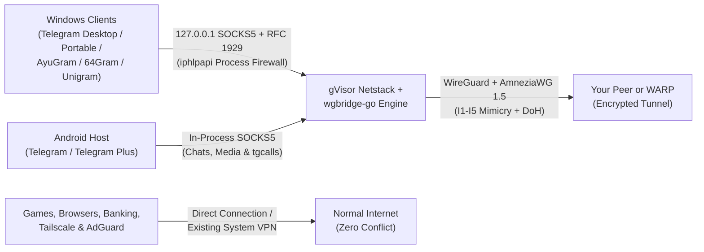

<div align="center">


<h1>WireGuard Plus - WireGuard &amp; AmneziaWG Inside Telegram</h1>

[](https://github.com/AliHaider704/wgplus/releases/latest)
[](https://github.com/AliHaider704/wgplus/releases)
[](https://github.com/AliHaider704/wgplus/actions)
[](LICENSE)
[](https://github.com/AliHaider704/wgplus/releases/latest)
[](https://github.com/AliHaider704/wgplus/releases/latest)

**WireGuard & AmneziaWG 1.5 inside Telegram only - bypass blocks and DPI throttling on Windows (userspace chat/media with zero VPN/Tailscale conflict, Portable ready, plus isolated Telegram-only call routing) and Android (zero root, keeps Android's VPN slot free) with encrypted voice & video calls.**

<p dir="ltr">
  <a href="README.ar.md">العربية (Arabic)</a> ·
  <a href="https://github.com/AliHaider704/wgplus/releases/latest">Download Windows / Android</a> ·
  <a href="docs/COMPARISON.md">Compare vs Proxies &amp; VPNs</a> ·
  <a href="docs/USER_GUIDE.md">User Guide</a>
</p>

</div>

---

[](https://github.com/AliHaider704/wgplus/actions/workflows/ci.yml) [](docs/QA_PIPELINE.md) [Privacy](docs/PRIVACY.md) | [FAQ](docs/FAQ.md)

## Downloads (`v2.0.0`)

| Platform | Download | Requirements | Notes |
|----------|----------|--------------|-------|
| **Windows Desktop (Single `.exe`, `17.83 MB`)** | [`WireGuardPlus-Windows-x64.exe`](https://github.com/AliHaider704/wgplus/releases/latest/download/WireGuardPlus-Windows-x64.exe) | Windows 10/11 x64 | Single executable, DPAPI vault, System Tray, isolated Telegram call routing |
| **Windows Portable (`.zip`, `6.87 MB`)** | [`WireGuardPlus-Windows-x64-Portable.zip`](https://github.com/AliHaider704/wgplus/releases/latest/download/WireGuardPlus-Windows-x64-Portable.zip) | Windows 10/11 x64, USB/folder | Includes `portable.flag`, zero AppData writes |
| **Android ARM64 (`5.05 MB`, Recommended)** | [`WireGuardPlus-2.0.0-arm64-v8a.apk`](https://github.com/AliHaider704/wgplus/releases/latest/download/WireGuardPlus-2.0.0-arm64-v8a.apk) | Android 5.0+ (arm64-v8a) | Rootless via LSPatch or Rooted via LSPosed / Vector |
| **Android ARMv7 (`5.02 MB`)** | [`WireGuardPlus-2.0.0-armeabi-v7a.apk`](https://github.com/AliHaider704/wgplus/releases/latest/download/WireGuardPlus-2.0.0-armeabi-v7a.apk) | Android 5.0+ (armeabi-v7a) | 32-bit Android devices |
| **Android Universal (`11.29 MB`)** | [`WireGuardPlus-2.0.0.apk`](https://github.com/AliHaider704/wgplus/releases/latest/download/WireGuardPlus-2.0.0.apk) | Android 5.0+ (arm64 + armv7a) | Universal fallback + auto-updater compatible |

Verify any download against [`SHA256SUMS.txt`](https://github.com/AliHaider704/wgplus/releases/latest/download/SHA256SUMS.txt), watch the [Walkthrough Video (`MP4`)](https://github.com/AliHaider704/wgplus/releases/download/v1.7.3/WireGuardPlus-Windows-Walkthrough.mp4), or join our [Official Telegram Channel](https://t.me/wgplus_official).

---

## Why WireGuard Plus?

In regions where Telegram is blocked or throttled with Deep Packet Inspection (such as **Iran, Iraq, Jordan**, and similar restricted networks), users usually settle for two flawed options:

- **Public MTProto / SOCKS5 proxies** burn quickly, inject sponsored channels, fail under DPI, and break or expose your IP during voice/video calls.
- **System-wide VPN apps** install Wintun drivers or take Android's sole VPN slot (breaking Tailscale, AdGuard, or work VPNs), slow down local apps and games, and force constant connect/disconnect juggling.

**WireGuard Plus** solves both by running a userspace **WireGuard + AmneziaWG 1.5** engine (`wireguard-go` + `gVisor` netstack) exclusively for Telegram:

| Feature | WireGuard Plus (Win + Android) | System VPN App | MTProto / SOCKS5 Proxy |
|---------|:------------------------------:|:--------------:|:----------------------:|
| **Tunnels only Telegram (browser, games, banking untouched)** | **Yes** | Split-tunnel workarounds only | Yes (chats only) |
| **Keeps VPN slot & Tailscale free (Zero Root on Android)** | **Yes** (isolated Telegram-only routes on Win) | No | Yes |
| **Multi-client Windows support (Portable Telegram, AyuGram, 64Gram, Unigram)** | **Yes** | Per-exe rules if supported | Manual per app |
| **Encrypted voice & video calls (Win Wintun L3 + Android `127.0.0.1` relays)** | **Yes** | Yes | Unreliable / breaks |
| **AmneziaWG 1.5 (`I1`-`I5` QUIC mimicry), WARP & Encrypted DoH** | **Yes** | Rare | No |
| **Strict Kill Switch + `iphlpapi` & Authenticode Loopback Firewall (Win)** | **Yes** | System-wide | No |
| **Zero channel spam / zero proxy ads** | **Yes** | Yes | Often ad-injected |

See the full breakdown in [WireGuard Plus vs Proxies & System VPNs](docs/COMPARISON.md).

---

## Screenshots & Walkthrough

### Windows Desktop

<div align="center">
  
</div>

<details>
<summary><strong>Animated Windows UI walkthrough (Zero-Admin launch, AWG 1.5, Light theme, QR & Arabic RTL)</strong></summary>

<div align="center">
  <br />
  
  <br />
  <sub>Prefer crisp 720p video? Download or stream <a href="https://github.com/AliHaider704/wgplus/releases/download/v1.7.3/WireGuardPlus-Windows-Walkthrough.mp4">WireGuardPlus-Windows-Walkthrough.mp4</a>.</sub>
</div>

</details>

### Android (In-App)

<div align="center">
  
</div>

<details>
<summary><strong>Animated Android UI walkthrough (Dark & Light themes, Encrypted DNS, AmneziaWG)</strong></summary>

<div align="center">
  <br />
  
</div>

</details>

---

## How It Works



- **Windows**: Detects installed & portable Telegram clients (`Telegram.exe`, `AyuGram.exe`, `64Gram.exe`, `Unigram.exe`, `Forkgram.exe`), tunnels chats/media via `127.0.0.1` SOCKS5 protected by an `iphlpapi` + Authenticode Loopback Process Firewall, and routes voice/video calls through an isolated `WireGuardPlusCalls` Wintun L3 adapter (`10.254.254.2/30`) scoped strictly to Telegram's 9 official call IPv4 CIDRs so browsers, games, Tailscale, and system VPNs stay untouched.
- **Android**: Embeds directly inside **Telegram** (`org.telegram.messenger`, `.beta`, `.web`), **Telegram Plus** (`org.telegram.plus`), **Nagram** (`xyz.nextalone.nagram`), **AyuGram** (`com.radolyn.ayugram`), **Telegraph** (`ir.ilmili.telegraph`, `ir.p2021.telegraph`), **Telegram Gold** (`org.telegram.gold`), **Telegram X** (`org.thunderdog.challegram`), and other `ApplicationLoader`-based forks via non-destructive `XC_MethodHook` hooks (LSPosed / Vector / LSPatch) so it coexists cleanly with modules like **TeleVip**.

> Unofficial community project; not affiliated with Telegram, WireGuard, Cloudflare, or Amnezia.

---

## Core Capabilities

- **True App-Level Isolation (Zero Android VPN Slot, Zero Tailscale Conflict):** Runs `wireguard-go` + `gVisor` in userspace (`desktopMode` tunes `8192`-deep netstack queues, `128`-packet batching, and `16 MB` TCP windows on PC) so OS traffic outside Telegram never enters the tunnel.
- **AmneziaWG 1.0 / 1.5 (`I1`-`I5`) & Cloudflare WARP:** Supports `Jc`/`Jmin`/`Jmax`, `S1`-`S4`, `H1`-`H4`, AmneziaWG 1.5 CPS signature packets (`I1`-`I5` QUIC mimicry), Cloudflare WARP `Reserved` header byte stamping, and 1-click anonymous **Free WARP (AWG 1.5)** profile generation on Windows.
- **Armored Loopback & Keystore Security (`v1.9.0`):** On Windows, combines an `iphlpapi` Process Firewall + `WinVerifyTrust` Authenticode verification, per-install random RFC 1929 SOCKS5 credentials, and strict fail-closed Kill Switch. On Android, enforces RFC 1929 SOCKS5 auth, caller signing-certificate verification in `KeepaliveStatusProvider`, fail-closed `WgKeystoreCrypto` (`AndroidKeyStore` / `0600` AES-256-GCM fallback, never plaintext), port `9` blackhole Kill Switch fallback, and passphrase-encrypted `.wgplus` exports flagged `IS_SENSITIVE`.
- **Voice & Video Calls Protected (`v1.9.0`):** On Android, creates dedicated per-endpoint local `127.0.0.1` UDP/TCP VoIP relays (`voip_relay.go`) directly inside the encrypted tunnel with P2P suppressed. On Windows, the embedded `WireGuardPlusCalls` Wintun L3 adapter (`v0.14.1`) carries `tgcalls` UDP/NAT packets strictly for Telegram's 9 call IPv4 CIDRs; keep `Calls -> Peer-to-Peer: Nobody` enabled inside Telegram Desktop for full IP privacy.
- **Encrypted DoH, Custom DoH & Tunnel Diagnostics:** Resolves endpoints over encrypted DoH (`1.1.1.1`, `1.0.0.1`, `8.8.8.8`, `9.9.9.9`, or your own custom DoH resolver) rejecting bogon/sinkhole IPs, verifies live Exit IP, Country, Telegram DC latency, and UDP readiness, and lets you copy structured diagnostic logs directly into [GitHub Bug Reports](.github/ISSUE_TEMPLATE/bug_report.yml).
- **DPAPI Vault, Portable Mode & Cross-Device Backups:** On Windows, secrets are encrypted with Windows DPAPI (`CryptProtectData`), Portable ZIP keeps all state inside `./wgplus-data/` beside `portable.flag`, and Argon2id + AES-256-GCM `.wgplus` passphrase backups transfer configs safely between PCs. On Android, keys use `AndroidKeyStore` (`AES-256-GCM`) and keys are stripped from world-readable sync mirrors.
- **Continuity, One UI Icon & Bilingual UI:** Automatic Sleep/Wake (`WM_POWERBROADCAST`) and IP change recovery (`handleNetworkSwitch`) + System Tray on Windows; 24/7 silent continuity on Android; adaptive + monochrome vector launcher icon for Samsung One UI; Dark & Light themes in English (LTR) and Arabic (RTL).

---

## Install

### Windows Quickstart (1 Minute)

Requires **Windows 10/11 (x64)** (WebView2 runtime is pre-installed on Windows 10/11).

1. Download [`WireGuardPlus-Windows-x64.exe`](https://github.com/AliHaider704/wgplus/releases/latest/download/WireGuardPlus-Windows-x64.exe) or extract [`WireGuardPlus-Windows-x64-Portable.zip`](https://github.com/AliHaider704/wgplus/releases/latest/download/WireGuardPlus-Windows-x64-Portable.zip).
2. Run `WireGuardPlus.exe` (single executable, no manual driver install needed).
3. Add a server via **Import `.conf`**, **Import QR** (image or `Ctrl+V` clipboard), **Paste**, or click **+ Free WARP (AWG 1.5)** for an instant obfuscated profile, then click **Connect**.
4. In the **Windows Telegram Clients** panel, pick your running client (Telegram Desktop, Telegram Desktop Portable, AyuGramDesktop Portable, 64Gram, Unigram, or click **+ Add Portable `.exe`**) and click **Apply Proxy**.
5. For voice & video call privacy on desktop, set **Telegram -> Settings -> Privacy and Security -> Calls -> Peer-to-Peer** to **Nobody** once, then click **Verify Route & Calls** in WireGuard Plus.

### Android Quickstart (3 Minutes, Rootless or Rooted)

Requires **Android 5.0+** (**Android 11+** for one-time silent Wireless Debugging activation).

1. Download [`WireGuardPlus-2.0.0-arm64-v8a.apk`](https://github.com/AliHaider704/wgplus/releases/latest/download/WireGuardPlus-2.0.0-arm64-v8a.apk) (`5.05 MB`), [`WireGuardPlus-2.0.0-armeabi-v7a.apk`](https://github.com/AliHaider704/wgplus/releases/latest/download/WireGuardPlus-2.0.0-armeabi-v7a.apk) (`5.02 MB`), or [`WireGuardPlus-2.0.0.apk`](https://github.com/AliHaider704/wgplus/releases/latest/download/WireGuardPlus-2.0.0.apk) (universal).
2. **Rootless (LSPatch):** Patch any supported client (**Telegram**, **Telegram Plus**, **Nagram**, **AyuGram**, **Telegraph**, **Telegram Gold**, **Telegram X**) using [JingMatrix LSPatch](https://github.com/JingMatrix/LSPatch) in **Portable** (embed WireGuard Plus + any other modules such as TeleVip) or **Local** mode, then install and open **WireGuard Plus** for one-time 6-digit Wireless Debugging pairing.
   - **Rooted (LSPosed / Vector):** Enable **WireGuard Plus** in **LSPosed / Vector -> Modules**, scope your Telegram client(s), reopen Telegram, and grant Root in WireGuard Plus for silent continuity.
3. Open **Telegram -> Settings -> Data and Storage -> Proxy Settings -> WireGuard**, import your `.conf` / QR screenshot / clipboard, tap **Connect**, and run **Verify route & calls**.

Full setup & troubleshooting steps are in [End-User Guide](docs/USER_GUIDE.md).

---

## Windows Verification, SmartScreen & Network Transparency

Verify your downloaded Windows binary against [`SHA256SUMS.txt`](https://github.com/AliHaider704/wgplus/releases/latest/download/SHA256SUMS.txt) in PowerShell:

```powershell
Get-FileHash .\WireGuardPlus-Windows-x64.exe -Algorithm SHA256
```

- **About SmartScreen / Defender heuristic warnings (`!ml`):** As an independent open-source project without a paid commercial Authenticode certificate, new Windows Go + Wails releases can trigger an initial *"Windows protected your PC"* prompt or generic heuristic flag. The binary uses **no UPX or runtime packers** and can be built cleanly from source or verified via GitHub Actions SLSA provenance in [`.github/workflows/release-windows.yml`](.github/workflows/release-windows.yml).
- **Outbound Network Transparency (opt-in error reports only, see docs/PRIVACY.md):** WireGuard Plus never runs analytics, ad networks, or crash uploaders. Every external connection is strictly one of:

| Purpose | Destination | Trigger |
|---------|-------------|---------|
| Encrypted WireGuard / AWG 1.5 tunnel packets | Your configured `.conf` peer UDP endpoint (or WARP) | Tunnel connect / active |
| Encrypted endpoint hostname resolution (DoH) | `1.1.1.1`, `1.0.0.1`, `8.8.8.8`, `9.9.9.9` (or your custom DoH URL) | Connect (when host is a domain) |
| Exit IP, Telegram DC & UDP readiness check | `one.one.one.one/cdn-cgi/trace`, `1.1.1.1:53`, Telegram DCs `1/2/4/5` via tunnel | Clicking **Verify Route & Calls** |
| Anonymous WARP device registration | `https://api.cloudflareclient.com/v0a2158/reg` | Clicking **+ Free WARP (AWG 1.5)** |
| GitHub release update check | `https://api.github.com/repos/AliHaider704/wgplus/releases/latest` | Startup / manual update check |

---

## Building from Source

```powershell
# 1. Windows Desktop (Go 1.26+ & Wails v2.17.1): runs Go tests + builds dist/*.exe & Portable.zip
powershell -ExecutionPolicy Bypass -File .\scripts\build-windows.ps1

# 2. Android Engine & APK (Go + NDK + gomobile + JDK 21 + Android SDK): outputs dist/*.apk
powershell -ExecutionPolicy Bypass -File .\scripts\build-wgbridge.ps1
.\gradlew.bat testReleaseUnitTest assembleRelease
```

See [Build Guide](docs/BUILD_GUIDE.md) for full prerequisites, attestation workflows, and release signing (`keystore.properties`).

---

## Project Layout

```text
desktop-win/    Windows desktop app (Go + Wails v2): Win32 iphlpapi Process Guard, DPAPI vault, client dispatcher, tray & WebView2 UI
app/            Android module (Java): Xposed/LSPatch hooks, UI, Keystore crypto, QR, sovereign continuity
wgbridge-go/    Shared Go engine: wireguard-go, AmneziaWG 1.0/1.5 + WARP, gVisor netstack, SOCKS5, HTTP CONNECT, DoH, kill switch
scripts/        Reproducible build scripts for Windows (build-windows.ps1) and Android (build-wgbridge.ps1)
docs/           User guide, comparison, architecture, build guide, security model, GitHub Pages, and media assets
```

---

## Documentation

- [WireGuard Plus vs Proxies & System VPNs](docs/COMPARISON.md)
- [End-User Installation & Troubleshooting Guide](docs/USER_GUIDE.md)
- [Build Guide](docs/BUILD_GUIDE.md)
- [Architecture](docs/ARCHITECTURE.md)
- [Security & Privacy Model](docs/SECURITY.md)
- [Changelog](CHANGELOG.md)
- [Contributing & Open Tasks](CONTRIBUTING.md)
- [Reporting Vulnerabilities](SECURITY.md)

---

## Credits

Built on [wireguard-go](https://git.zx2c4.com/wireguard-go), [gVisor](https://gvisor.dev), [Wails v2](https://wails.io), [gomobile](https://pkg.go.dev/golang.org/x/mobile), [ZXing](https://github.com/zxing/zxing), [gozxing](https://github.com/makiuchi-d/gozxing), [libadb-android](https://github.com/MuntashirAkon/libadb-android), [Conscrypt](https://conscrypt.org/), and obfuscation protocols from [AmneziaWG](https://github.com/amnezia-vpn/amneziawg-go). Each component retains its respective license.

## License

[MIT](LICENSE)
