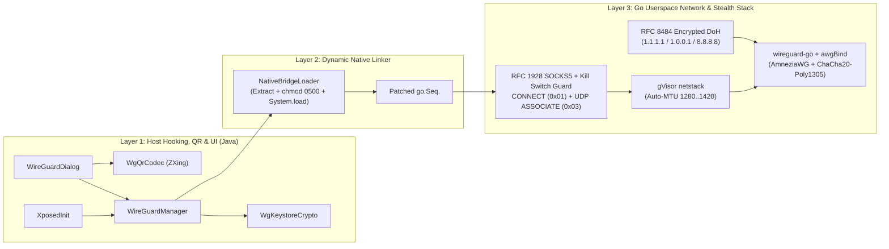

# Architecture Deep Dive

## 1. System Design Goals

**WireGuard Plus (`v1.4.0`)** solves six engineering challenges simultaneously:
1. **Per-App Tunneling Without `VpnService`**: Runs a complete WireGuard / AmneziaWG cryptographic and TCP/UDP/IP stack inside Telegram's userspace process so no system-wide VPN slot or root privilege is required.
2. **DPI Censorship Resistance & Zero Leak Resilience**: Supports AmneziaWG packet obfuscation (`Jc`, `Jmin`, `Jmax`, `S1..S4`, `H1..H4`), direct-IP Encrypted DoH (`RFC 8484`) endpoint resolution, and a fail-closed loopback SOCKS5 Kill Switch.
3. **Full Messaging + VoIP Call Coverage**: Routes both Telegram's C++ `tgnet` MTProto sockets (TCP) and `tgcalls` WebRTC voice/video media streams (UDP/TCP) through the encrypted tunnel without P2P IP leaks.
4. **24/7 Silent Hybrid Continuity (`v1.4.0`)**: Eliminates ongoing foreground service notifications (`49107`) and Samsung `"1 active app"` indicators by combining a pure-SDK **Shizuku** client (`ShizukuBridge`, `uid=2000`, `IActivityManager.setProcessImportant`, Doze/MARs/NetPolicy whitelisting) with a zero-capture `NotificationListenerService` Boot Guard (`KeepaliveBridgeListenerService` holding `BIND_AUTO_CREATE | BIND_IMPORTANT | BIND_INCLUDE_CAPABILITIES`), coordinated synchronously over `KeepaliveStatusProvider` with transparent FGS fallback.
5. **Rootless LSPatch & Android 14-17 Compatibility**: Loads native Go shared libraries cleanly inside LSPatch's `InMemoryDexClassLoader` under strict HiddenAPI and read-only Dynamic Code Loading (`0500`) enforcement.
6. **Zero-Conflict TeleVip Coexistence**: Uses additive `XC_MethodHook` callbacks and isolated preferences so other Telegram Xposed modules operate undisturbed.

---

## 2. Three-Layer Runtime Architecture

### Layer 1: Host Hooking, Keystore Security, QR Codec & Progressive-Disclosure UI
- **`XposedInit`**: Attaches non-destructive `XC_MethodHook` listeners:
  1. `ApplicationLoader.onCreate`: Registers `ActivityLifecycleCallbacks` for Smart Idle Keepalive, enforces Strict Kill Switch immediately if enabled, and runs asynchronous auto-connect.
  2. `ProxyListActivity.createView`: Appends a compact typographic trigger button (`wg_plus_floating_trigger`) with a live semantic status dot directly onto the root `FrameLayout`.
  3. `Instance.makeNativeInstance` & `VoIPController.start`: Injects `Instance$Proxy("127.0.0.1", effectivePort, "", "")` into Telegram's VoIP media engine.
  4. `Activity.onActivityResult` & `LaunchActivity.onActivityResult`: Captures strictly `0x5747` (`.conf` file import) and `0x5748` (gallery QR image import).
  5. `NotificationsService.onStartCommand` & `onBind`: Queries `KeepaliveStatusProvider` (`ensure_stealth`); when Hybrid (`adj=200` `force-imp` via `ShizukuBridge`) or silent Boot Guard (`KeepaliveBridgeListenerService` `0x1041` binding) protects the host PID, omits `startForeground` and cancels any stale notification (`49107`), otherwise promoting safely to Foreground Service.
- **`WgQrCodec`**: Uses pure-Java `com.google.zxing:core` to generate scannable QR bitmaps and decode gallery screenshots (including inverted dark-mode QR screenshots) with zero `CAMERA` permission.
- **`WgKeystoreCrypto`**: Wraps `PrivateKey` and `PresharedKey` values using a non-exportable 256-bit `AES/GCM/NoPadding` key inside `AndroidKeyStore`.

### Layer 2: LSPatch Native Extraction & `go.Seq` Initialization
`NativeBridgeLoader` extracts `lib/<abi>/libgojni.so` across direct module paths, `outer.apk!/inner`, `cache`/`code_cache`, or `assets/lspatch/*` (`.apk` and `.bin`), enforces `Os.chmod(path, 0500)`, and invokes `System.load` + `Seq.touch()`. Because `scripts/build-wgbridge.ps1` wraps `System.loadLibrary("gojni")` inside `go/Seq.java` with `try { ... } catch (UnsatisfiedLinkError ignored) {}`, initialization succeeds deterministically inside LSPatch's `InMemoryDexClassLoader`.

### Layer 3: Go `wireguard-go` + `awgBind` + `DoH` + `gVisor netstack` + `SOCKS5`
Inside `wgbridge-go/`:
1. **`doh.go`**: Resolves endpoint domains directly over HTTPS (`1.1.1.1`, `1.0.0.1`, `8.8.8.8`) using RFC 8484 wireformat `A` queries and rejects ISP sinkhole IPs (`0.0.0.0`, `127.0.0.0/8`).
2. **`awg_bind.go`**: Wraps `conn.Bind` to emit `Jc` random junk datagrams (`[Jmin..Jmax]` bytes) before handshakes, prepend `S1..S4` random padding, remap message headers (`H1..H4` single or range), and recalculate BLAKE2s-128 `MAC1` digests so WireGuard handshakes become indistinguishable from random UDP noise on censored networks.
3. **`diagnostics.go`**: Provides `StartKillSwitchGuard` (fail-closed loopback SOCKS5 port), `ProbeEndpointHandshakeMs` (isolated concurrent handshake ping), and `DiscoverOptimalMTU` (`1420 -> 1280` path MTU prober).
4. **`bridge.go`**: Binds `netstack.CreateNetTUN` and serves RFC 1928 SOCKS5 (`CMD = 0x01` TCP + `CMD = 0x03` VoIP `UDP ASSOCIATE`) on `127.0.0.1:0`.
