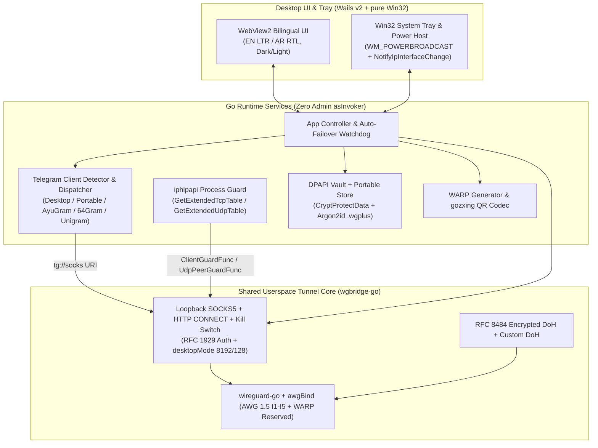
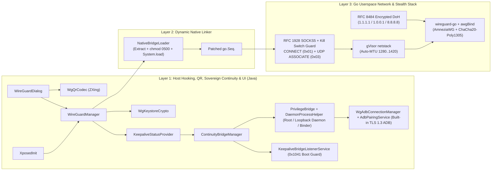

# Architecture Deep Dive

## 1. System Design Goals

**WireGuard Plus (`v1.9.0`)** shares a single userspace Go networking core (`wgbridge-go/`) across **Windows Desktop** (`desktop-win/`) and **Android** (`app/`) to solve six engineering challenges without requiring Android Root or routing non-Telegram OS traffic through the tunnel:

1. **Per-App Tunneling With Isolated VoIP Routing:** Runs a complete WireGuard / AmneziaWG 1.5 cryptographic and TCP/UDP/IP stack (`wireguard-go` + `gVisor` netstack) exclusively for Telegram: messaging uses loopback SOCKS5 (`127.0.0.1`), Android VoIP uses per-endpoint local `127.0.0.1` UDP/TCP relays (`voip_relay.go`), and Windows VoIP uses an embedded signed Wintun L3 adapter (`WireGuardPlusCalls`) routed strictly to Telegram's 9 official VoIP IPv4 CIDRs so browsers, games, Tailscale, AdGuard, corporate VPNs, and Android's single `VpnService` slot remain untouched.
2. **DPI Censorship Resistance & Zero-Leak Fail-Closed Design:** Supports AmneziaWG 1.0/1.5 (`Jc`/`Jmin`/`Jmax`, `S1`-`S4`, `H1`-`H4` with `MAC1` recomputation, and CPS signature packets `I1`-`I5` for QUIC mimicry), Cloudflare WARP 3-byte `Reserved` header stamping in `[1..3]` after standard WireGuard `MAC1`/`MAC2` calculation (stripped prior to inbound `MAC1` verification), direct-IP Encrypted DoH (`RFC 8484`) with optional custom DoH resolver, and a fail-closed loopback Kill Switch.
3. **Armored Windows Loopback Security (`desktop-win/`, Zero Admin):** Combines a non-privileged `iphlpapi.dll` Process Guard (`GetExtendedTcpTable` / `GetExtendedUdpTable` PID-to-EXE verification), per-install random RFC 1929 SOCKS5 authentication, Windows DPAPI (`CryptProtectData`) secret encryption, optional Portable Mode (`portable.flag`), and Argon2id + AES-256-GCM `.wgplus` encrypted backups.
4. **Windows Multi-Client & Power Continuity:** Auto-detects and dispatches `tg://socks` URIs across Telegram Desktop, Telegram Portable, AyuGramDesktop, 64Gram, Forkgram, and Microsoft Store Unigram; handles `WM_POWERBROADCAST` sleep/wake events and `NotifyIpInterfaceChange` IP transitions; runs natively in the Windows System Tray with zero UAC elevation (`asInvoker`).
5. **Android Sovereign Silent Continuity (`v1.5.0+`):** Eliminates external helper dependencies and persistent FGS notifications via built-in SPAKE2 + TLS 1.3 Wireless Debugging pairing, detached `wgplus_daemon` / Root `PrivilegeBridge`, and zero-capture `KeepaliveBridgeListenerService`.
6. **Clean Coexistence:** Android hooks strictly use non-destructive `XC_MethodHook` listeners so companion modules like **TeleVip** operate undisturbed; Windows binds loopback proxies strictly to `127.0.0.1` (`48729` primary) and limits the `WireGuardPlusCalls` adapter strictly to Telegram call CIDRs with direct peer-endpoint exclusion.

---

## 2. Shared Go Userspace Core (`wgbridge-go/`)

The shared `wgbridge-go` module powers both platforms (compiled directly on Windows Desktop via `replace wgbridge => ../wgbridge-go`, and cross-compiled via `gomobile` for Android):

1. **`fast_netstack.go`**: Wraps `gVisor` (`tcpip/stack` + `channel.Endpoint`) with automatic platform tuning (`SetDesktopMode`): mobile uses `2048` queue / `64` batch / `4 MB` TCP max windows, while Windows Desktop scales to `8192` queue / `128` batch / `16 MB` TX/RX windows, parallel cached tunnel DNS (`15s` to `300s` TTL), and dynamic `atomic.Bool` `SetBlockIPv6`.
2. **`awg_bind.go`**: Wraps `conn.Bind` to inject pre-handshake random junk datagrams (`Jc`/`Jmin`/`Jmax`), `I1`-`I5` AmneziaWG 1.5 CPS signature packets (`<b>`, `<r>`, `<rc>`, `<rd>`, `<t>`, `<c>`), header obfuscation (`H1`-`H4` with BLAKE2s-128 `MAC1` recomputation), payload padding (`S1`-`S4`), and Cloudflare WARP 3-byte `Reserved` header stamping in `[1..3]` outside WireGuard `MAC1`/`MAC2` (stripped prior to inbound `MAC1` verification).
3. **`doh.go`**: Resolves endpoint hostnames directly over HTTPS (`1.1.1.1`, `1.0.0.1`, `8.8.8.8`, `9.9.9.9`) using RFC 8484 wireformat `A` queries plus optional user-configured `SetCustomDoH`, rejecting ISP sinkhole IPs (`0.0.0.0`, `127.0.0.0/8`) without plaintext port-53 leakage.
4. **`bridge.go` & `http_proxy.go`**: Binds `netstack.CreateNetTUN` and serves fail-closed loopback SOCKS5 (`CMD = 0x01` TCP + `CMD = 0x03` VoIP `UDP ASSOCIATE`, optional RFC 1929 `SetSocksAuth`, `desktopTcpCopyBufSize = 256 KB`, up to `256` desktop UDP relay sessions) alongside an optional `127.0.0.1` `HTTP CONNECT` listener (`StartHttpProxy`, default port `48739`).
5. **`desktop_api.go` / `desktop_api_android.go`, `voip_relay.go`, `voip_tun_windows.go`, `diag.go` & `telemetry.go` / `diagnostics_calls.go`**: Build-tag-isolated (`//go:build !android`) `ClientGuardFunc` / `UdpPeerGuardFunc` process firewall hooks, cross-platform local `127.0.0.1` UDP/TCP VoIP endpoint relays (`StartVoipEndpointRelay`, 16-relay cap, 90s idle reaper), Windows Wintun L3 call adapter (`StartWindowsVoipTun` on `WireGuardPlusCalls`, `10.254.254.2/30`, MTU `1280`, strictly 9 Telegram IPv4 CIDRs), structured ring-buffer telemetry (`RecordDiag`, `GetDiagnosticsJSON`), `ProbeEndpointHandshakeMs`, `DiscoverOptimalMTU`, and `VerifyRouteAndCallsJSON`.

---

## 3. Windows Desktop Armored Runtime (`desktop-win/`)

- **`internal/guard/process_guard_windows.go`**: Implements local firewall verification via `iphlpapi.dll` (`GetExtendedTcpTable` / `GetExtendedUdpTable`), `QueryFullProcessImageName` (`PROCESS_QUERY_LIMITED_INFORMATION`), and `WinVerifyTrust` Authenticode verification (`verifyAuthenticodeCached`). Unrecognized or spoofed processes hitting loopback listeners are blocked and logged in `Strict` mode.
- **`internal/voiptun/embed_windows.go`**: Embeds signed `wintun.dll` (`v0.14.1`) and extracts it alongside the application executable via `EnsureWintunDLLForApp` prior to `StartWindowsVoipTun`.
- **`internal/clients/telegram_clients_windows.go`**: Discovers running processes (`CreateToolhelp32Snapshot`), installed registries/shortcuts, MSIX Unigram packages, and portable `tdata` folders, and dispatches `tg://socks?...` URLs cleanly while tracking per-client connections and bytes.
- **`internal/vault/dpapi_windows.go`**: Detects `portable.flag` or sibling `wgplus-data/` directory (`ResolveDataDir`) to keep all encrypted state and WebView2 cache local; encrypts secrets using Windows DPAPI (`CryptProtectData` with `CRYPTPROTECT_UI_FORBIDDEN`) and supports portable password-derived Argon2id + AES-256-GCM `.wgplus` backups.
- **`internal/syswin/`**: Manages single-instance locking, hidden top-level Win32 message loop for pure-Go tray menus and `WM_POWERBROADCAST` suspend/resume callbacks, `NotifyIpInterfaceChange` network debouncing, `CF_DIB` clipboard QR scanning (`internal/qr/`), and optional `HKCU` non-admin autostart (`--minimized`).

---

## 4. Android Three-Layer Runtime Architecture (`app/`)

### Layer 1: Host Hooking, Keystore Security, QR Codec & Sovereign Continuity
- **`XposedInit`**: Attaches non-destructive `XC_MethodHook` listeners:
  1. `ApplicationLoader.onCreate`: Registers `ActivityLifecycleCallbacks` for Smart Idle Keepalive, enforces Strict Kill Switch immediately if enabled, and runs asynchronous auto-connect.
  2. `ProxyListActivity.createView`: Appends a compact typographic trigger button (`wg_plus_floating_trigger`) with a live semantic status dot directly onto the root `FrameLayout`.
  3. `Instance.makeNativeInstance` & `VoIPController.start`: Injects authenticated `Instance$Proxy("127.0.0.1", effectivePort, socksUser, socksPass)` (or fail-closed port `9` when Kill Switch is armed and the tunnel is down) and rewrites non-loopback VoIP `Endpoint` objects (`ipv4`/`port`) through `KeepaliveStatusProvider` (`METHOD_START_VOIP_RELAY`) -> `voip_relay.go` (`127.0.0.1:<relayPort>`).
  4. `Activity.onActivityResult` & `LaunchActivity.onActivityResult`: Captures strictly `0x5747` (`.conf` file import) and `0x5748` (gallery QR image import).
  5. `NotificationsService.onStartCommand` & `onBind`: Queries `KeepaliveStatusProvider` (`ensure_stealth`); when Sovereign (`adj=200` `force-imp` via `PrivilegeBridge` / `wgplus_daemon`, or Root `oom_score_adj = -800`) or silent Boot Guard (`KeepaliveBridgeListenerService` `0x1041` binding) protects the host PID, omits `startForeground` and cancels any stale notification (`49107`), otherwise promoting safely to Foreground Service.
- **`ContinuityBridgeManager` + `PrivilegeBridge` + `WgAdbConnectionManager`**:
  1. One-time 6-digit SPAKE2 + TLS 1.3 Wireless Debugging pairing (`AdbPairingService` + `NsdManager` `_adb-tls-pairing._tcp`) registers WireGuard Plus's hardware-protected RSA-2048 identity on Android 11+ with no external helper apps.
  2. Over Wi-Fi (`_adb-tls-connect._tcp`) or dynamic loopback TCP (`127.0.0.1:<adb_tcp_port>`) on Mobile Data, `PrivilegeBridge` grants `SET_PROCESS_LIMIT`, `WRITE_SECURE_SETTINGS`, and Doze/MARs/NetPolicy/standby exemptions, and launches a detached `wgplus_daemon` (`/system/bin/app_process`) that exposes an authenticated `127.0.0.1` loopback control socket (`256-bit` per-session hex token).
  3. `BootContinuityReceiver` and passive `ConnectivityManager.NetworkCallback` restore `wgplus_daemon`, notification listener bindings, and process importance automatically across reboots and Wi-Fi / Mobile Data transitions.
- **`WgQrCodec`**: Uses pure-Java `com.google.zxing:core` to generate scannable QR bitmaps and decode gallery screenshots (including inverted dark-mode QR screenshots) with zero `CAMERA` permission.
- **`WgKeystoreCrypto`**: Wraps `PrivateKey`, `PresharedKey`, and the built-in Wireless ADB private key using a non-exportable 256-bit `AES/GCM/NoPadding` key inside `AndroidKeyStore` (`enc:v1:`), falling back strictly to an isolated `0600` file-backed AES-256-GCM key (`enc:v2:`) in `noBackupFilesDir` (never plaintext).
- **`WgDiagnosticsLog`**: Collects structured Go + Java telemetry into a sanitized diagnostic bundle copyable directly into `.github/ISSUE_TEMPLATE/bug_report.yml`.

### Layer 2: LSPatch Native Extraction & `go.Seq` Initialization
`NativeBridgeLoader` extracts `lib/<abi>/libgojni.so` across direct module paths, `outer.apk!/inner`, `cache`/`code_cache`, or `assets/lspatch/*` (`.apk` and `.bin`), enforces `Os.chmod(path, 0500)`, and invokes `System.load` + `Seq.touch()`. Because `scripts/build-wgbridge.ps1` wraps `System.loadLibrary("gojni")` inside `go/Seq.java` with `try { ... } catch (UnsatisfiedLinkError ignored) {}`, initialization succeeds deterministically inside LSPatch's `InMemoryDexClassLoader`.
